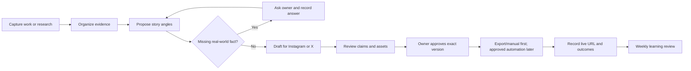

# Founder Content Engine: product plan

## 1. Product direction

Build a personal content workspace that turns real building activity into credible Instagram and X content, supports relevant conversations, and helps generate qualified inbound enquiries.

Primary outcomes: potential client enquiries and relationships with technical founders/builders. Facebook and YouTube follow once the first workflow is useful. This is initially a personal tool; SaaS billing, tenant administration, and team workflows are outside the initial scope.

Confirmed source material: demo sites/sites available for content and actively used in-house tools involving management, leads, automations, and operations. Internal usage is owner-confirmed; measurable outcomes and public disclosure boundaries still need confirmation. Internal usage does not establish external client results.

Confirmed delivery capabilities: modern websites, automations, AI agents, workflows, and custom tools. Potential buyers include local service businesses, coaches, law/real-estate businesses, clinics, content creators needing technical support, and smaller agencies needing tools. This is a service capability map, not evidence of clients in each sector. The confirmed first-month focus is local service businesses needing websites and follow-up systems. Other groups remain secondary.

The budget is zero additional spend beyond the existing ChatGPT Plus subscription. The latest confirmed capture allowance is up to 10 hours per week, superseding the earlier two-hour limit. This is a ceiling, not a production target; total time including editing and review remains uncommitted. Reviewing is flexible. Manual publishing is acceptable initially; the desired destination is automatic publishing after approval. Prefer BTS, screen recordings, demonstrations, and occasional face appearances over frequent talking-head videos.

Public identity: your own name, backed by ExpandR. English is the priority language. Present useful business explanations first, with optional technical depth for builders.

## 2. Improvements over the original brief

| Original emphasis | Improved approach | Reason |
|---|---|---|
| Monitor many platforms continuously | Capture your work first; add a small selected research feed | Original content needs original inputs |
| Generate many angles per discovery | Suggest a few defensible angles with evidence and missing questions | Reduce review burden and invented stories |
| Ten potential agents | A controlled pipeline of modular tasks | Easier to inspect, retry, and budget |
| Broad content formats from day one | Instagram carousel/reel outline and X post/thread first | Match confirmed channels |
| Generic review queue | Claim review, personal observation confirmation, and version-specific approval | Make authenticity enforceable |
| Engagement analytics | Connect posts to conversations, enquiries, and audience fit | Match the business objective |
| Large central dashboard | A daily work queue that leads to the next useful action | Avoid decorative reporting |

## 3. Editorial foundation

Keep the three pillars, with practical boundaries:

1. **Builder:** demonstrate a site, explain a technical decision, show a workflow, or document a reproducible experiment.
2. **Founder:** explain a business problem being explored, an offer being tested, or a decision actually made. Do not imply paying customers, sales, or growth without confirmation.
3. **Operator/thinking:** examine how a tool might improve a workflow, or explain lessons from confirmed internal usage. Label hypotheses and opinions clearly.

The content unit is an **evidence-backed story**: one audience problem, one useful observation, supporting material, and an honest takeaway. A story can produce several platform versions; it does not have to become every possible format.

Possible stories, conditional on inspection and confirmation:

- Demo site: explain the design choices intended to make an enquiry flow clearer. Do not call it a conversion improvement without measurements.
- Leads tool: show how a lead moves through the interface. Claim internal adoption only after confirmation.
- Management tool: explain an implementation tradeoff and show the relevant screen or code. Claim time saved only if measured with a clear baseline.

A demo is valuable evidence of building ability. It is not evidence of client demand or business results.

## 4. Core workflow

Capture should ask: what did you build/change, what problem does it address, what actually happened, what evidence exists, and what can be public? A screenshot alone cannot establish a business outcome.

Research supplies context or a question to investigate. It must not silently become your experience. If a source is inaccessible, keep its URL and request an excerpt rather than inventing a summary.

## 5. MVP scope

### Include

The zero-additional-cost version uses an assistant-operated workspace during active sessions. The assistant researches and prepares drafts; the owner reviews and approves. Embedded paid AI calls are not a prerequisite, and the owner is not responsible for copy/paste prompt handoffs. Unattended execution needs a separately verified supported integration.

- A personal profile: audience, offer, pillars, prohibited claims, preferred language, and voice examples supplied by you.
- Project records, manual notes, URLs, screenshot uploads, and explicit public-use permissions.
- Evidence library with source links, dates, evidence type, and confirmation status.
- Idea backlog with short angle explanations and links to supporting material.
- Targeted questions when a draft needs a personal observation, outcome, opinion, or permission.
- X standalone posts and threads; Instagram carousel copy and reel outlines.
- A basic carousel preview/export using a small reusable template set; screenshots, diagrams, and text first.
- Editable drafts, version history, section regeneration, fact review, and approval.
- Calendar planning, copy/export, manual publishing confirmation, and live URL storage.
- Manual metric snapshots and an enquiry/conversation log.
- Search, filtering, persistence, recoverable job failures, and clear empty states.

### Defer

- Automatic social publishing and direct metric integrations in the initial pilot. Approval-triggered publishing is a required later capability, subject to verifying a supported zero-cost route for each account and format.
- Broad autonomous social monitoring and trend prediction.
- GitHub synchronization; begin with selected files/links and notes.
- Generated video production, voice cloning, and complex image generation.
- Facebook and YouTube distribution workflows.
- Multi-user teams, billing, mobile apps, and a general-purpose agent framework.

These are sequencing decisions, not claims that integrations are unavailable. Prioritize BTS/screen-demo storyboards and simple recording shot lists. Use occasional face appearances at your discretion; do not build a talking-head production dependency.

## 6. Product screens

| Screen | Main job | Required useful action |
|---|---|---|
| Today | Show unresolved confirmations, work ready to draft, and planned posts | Open the next actionable item |
| Capture & Projects | Store projects, build notes, and approved assets | Add a real observation and its evidence |
| Research | Maintain selected references and a reading queue | Save a source and explain its relevance |
| Ideas | Evaluate story candidates | Select an angle or explain rejection |
| Studio | Write and adapt a story | Edit copy, inspect claims, preview a carousel |
| Review | Resolve factual and personal questions | Confirm, correct, reject, or approve a version |
| Calendar | Plan approved content | Move a planned date and record publication |
| Outcomes | Review audience fit and enquiries | Log a conversation and trace it to a post |
| Settings | Configure voice, sources, providers, and limits | Change preferences without modifying code |

Research can initially be a tab inside Capture; Review can be a filtered Studio view. Screen count is not a requirement for separate implementations.

Visual direction: calm editorial layout, readable type, restrained accent color, and real product screenshots. Brand colors and fonts remain unconfirmed; BTS and screen demos with limited face appearances are confirmed preferences.

## 7. Platform treatment

**X:** a concise observation or a technical argument with proof. Use a thread only when the explanation benefits from a sequence. Retain specifics and caveats; avoid manufactured controversy.

**Instagram:** a visual explanation, demonstration, or short narrated sequence. Carousels need a clear progression and a useful conclusion; reels need a demonstrable action, storyboard, and recording notes. Do not merely split an X thread into slides.

**Later Facebook:** validate the intended audience and whether the destination is a profile, page, or community before designing distribution.

**Later YouTube:** validate recording capacity and short versus long-form intent before investing in video tooling.

## 8. Opportunity selection

First check eligibility: public use permitted, no unresolved essential claims, and a useful angle for the intended audience. Unsupported ideas remain research or experiment proposals.

Then rank eligible ideas with transparent 0–3 editorial ratings for audience fit, evidence strength, distinctiveness, practical usefulness, and production effort. Show the reasoning. Do not display predicted virality or a fabricated probability of success.

Timeliness is a tie-breaker, not the reason to publish. Repeated or weak ideas can be archived without generating drafts.

## 9. Operating rhythm and success

Proposed rhythm within the confirmed capture ceiling of 10 hours per week; start below that ceiling and measure effort:

- Capture a short note when something worth explaining happens.
- Select a small weekly batch of stories you can substantiate.
- Review copy and visuals together, then publish manually.
- Log meaningful replies and enquiries; review results weekly.

Pilot two stories per week, each adapted into an Instagram asset and an X post/thread: four platform items total. This is a proposed experiment, not a confirmed quota. Track recording, editing, review, and posting time separately before increasing output. If little new work is available, revisit a confirmed tutorial or document an experiment rather than inventing progress.

Measure content production effort, fraction of drafts approved, factual corrections, useful builder conversations, and qualified enquiries. Define a qualified enquiry after the target buyer and offer are confirmed. Attribute leads as self-reported, directly tracked, inferred, or unknown; do not imply causal certainty.

For engagement comparisons, retain platform, format, observation date, and time since publication. Missing metrics are unknown, not zero. Small samples generate hypotheses rather than confident strategy changes.

## 10. Delivery sequence

| Stage | Deliverable | Exit condition |
|---|---|---|
| 0: Confirm reality | Select public-safe project, exact observations, account setup, and voice samples | Known audience, budget, capture allowance, and brand recorded; remaining unknowns visible |
| 1: Manual pilot | Use one real project to prepare an X draft and Instagram concept | Owner considers both accurate, useful, and recognizably theirs |
| 2: Core workspace | Capture → evidence → idea → draft → review → export | End-to-end flow persists through refresh and handles missing facts |
| 3: Visual workflow | Carousel templates and export | A real carousel is readable on mobile and can be published |
| 4: Outcome loop | Publication records, metric snapshots, enquiry log | Weekly review uses actual records with transparent attribution |
| 5: Selective automation | Only the connectors that remove observed repetitive work | Access, cost, reliability, and approval behavior verified |

No delivery dates are committed. The zero-additional-spend constraint is confirmed; hosting and integration eligibility still need verification. The immediate next step is selecting one shareable project for the manual pilot, not building every module simultaneously.

## 11. Initial content and inbound structure

Proposed message: “I build practical websites and follow-up systems for local service businesses, and share how we build and use them at ExpandR.” This describes the confirmed capability and internal usage without inventing client outcomes.

Use three recurring series:

- **Website walkthrough:** show an enquiry journey, mobile usability decision, or booking interface. Explain intended benefits without claiming measured conversion gains.
- **Follow-up system walkthrough:** demonstrate a confirmed internal workflow with synthetic or redacted lead data. Distinguish what currently runs from proposed client adaptations.
- **Behind the build:** show a technical decision, failure, fix, or AI-assisted workflow that actually occurred. Offer enough context for nontechnical buyers and optional implementation detail for builders.

Suggested initial experiment: three buyer-facing stories for every one deeper builder story. This is a testable editorial proposal, not a proven platform formula.

Use one clear enquiry destination in profile links once the owner confirms it. Relevant posts may invite readers to discuss a website or follow-up problem; not every post needs a sales CTA. Track enquiry source, business type, problem, desired outcome, next step, and qualification. Do not automate unsolicited outreach or promise results.

## 12. Zero-additional-cost operating mode

Ownership: the assistant performs discovery, research, preparation, and routine editorial choices. The owner reviews and approves. See [Research and operator workflow](04-research-and-operator-workflow.md) for coverage, initial references, and execution limits.

1. Capture screenshots, short screen recordings, and notes on the existing machine.
2. Store projects, evidence, questions, and drafts locally; use existing storage for backups.
3. The assistant prepares evidence packets and platform drafts using available session tools, retaining source IDs and unresolved claims. The owner receives completed review packets rather than prompt-transfer tasks.
4. Create visual assets from local templates; record real demos instead of depending on paid media generation.
5. Approve the exact copy and assets; publish manually during the pilot.
6. Add approval-triggered scheduling only after checking account eligibility, supported formats, quotas, and a genuinely zero-cost execution path. Show a manual fallback for unsupported formats/accounts.

ChatGPT Plus does not include separately billed API usage. The official page describes eligible access through participating tools, but eligibility for this custom application is unverified and is not an assumed backend. [OpenAI Plus documentation](https://help.openai.com/en/articles/6950777-what-is-chatgpt-plus)

The intended automated flow is: approve exact version + destination account + posting time → queue → publish → record platform ID → reconcile errors. No second confirmation is needed for an unchanged post already authorized for that account/time. Editing invalidates approval. A local scheduler can only run while its host is available; dependable unattended operation needs an explicitly verified execution environment.
